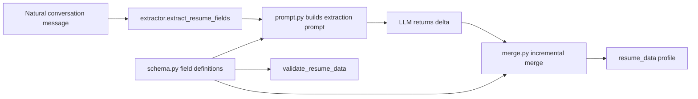

# passive-resume-extractor

[](LICENSE)

**English** | [简体中文](README.md)

A **schema-driven "passive resume extraction" library**: while the user chats naturally, it extracts *only* the information the user volunteered, and merges it into an existing profile as an **incremental delta** — **never overwriting, never asking follow-up questions, never fabricating**.

Zero third-party runtime dependencies — Python standard library only.

## Core ideas

- **Passive extraction**: extract only when the user brings something up. No probing, no prompting.
- **Delta merge**: the LLM returns *only this turn's changes*, and `merge.py` applies them per field type, so earlier facts are never wiped out by later conversation turns.
- **Schema-driven**: field definitions, validation and the extraction prompt are all generated from `schema.py` — add one field definition and the prompt updates itself. No second copy of the prompt to maintain.

## Architecture



The schema covers 7 modules: job intent, personal info, education, work/internship experience, project experience, skills & certificates, and other personalized info.

## Quick start

```python
import asyncio
from passive_resume_extractor import (
    extract_resume_fields,
    merge_extracted_fields,
    new_empty_resume_data,
)


class MyLLM:
    """Any client exposing an async chat_json (DeepSeek / OpenAI / local model)."""

    async def chat_json(self, system_prompt, user_input, **kwargs):
        # Call your LLM and return this turn's extracted fields
        return {"target_position": "Backend Engineer", "target_location": "Hangzhou"}


profile = new_empty_resume_data()

delta = asyncio.run(
    extract_resume_fields("I'm looking for a backend role in Hangzhou", profile, MyLLM())
)
merge_extracted_fields(profile, delta)

print(profile["target_position"])  # Backend Engineer
```

The LLM client is duck-typed: any object with an `async chat_json(system_prompt, user_input, **kwargs)` coroutine works.

## Delta merge strategy

| Field type | Merge strategy | Example keys |
| --- | --- | --- |
| Scalar | Overwrite | `name`, `phone`, `target_position` |
| Dict | `update()` merge | `hard_skills`, `language_skills` |
| List | Deduplicated append | `certificates`, `soft_skills` |
| Repeated group (list of dicts) | `_op: add` to append / `_op: update` with `_match` to update in place | `education_list`, `work_experience_list`, `project_experience_list` |

A repeated-group delta looks like this:

```json
{
  "education_list": [
    {"_op": "update", "_match": {"school": "Some University"}, "gpa": "3.8/4.0"}
  ]
}
```

Tip: run `validate_resume_data()` after `merge_extracted_fields()` to reject/repair malformed values.

## Customizing the schema

Add a `ResumeFieldDef` entry in `schema.py`; the extraction prompt and validation follow automatically:

```python
ResumeFieldDef(
    key="github",
    label="GitHub profile",
    field_type=FieldType.STRING,
    required=False,
    module=ResumeModule.OTHER_INFO,
    extraction_hint="GitHub / code repository links the user mentions",
)
```

## Project layout

```
passive_resume_extractor/
├── schema.py       # 7-module field definitions, validation, profile flattening
├── merge.py        # delta merge (scalar / dict / list / repeated group)
├── prompt.py       # schema-driven extraction prompt
└── extractor.py    # extraction entry point (duck-typed LLM client)
tests/
├── test_schema.py
├── test_merge.py
└── test_extractor.py
```

## Installation

```bash
pip install .          # or: pip install -e ".[dev]"
```

Requires Python >= 3.9.

## Testing

```bash
python -m pip install pytest
python -m pytest tests/
```

## License

[MIT](LICENSE)
