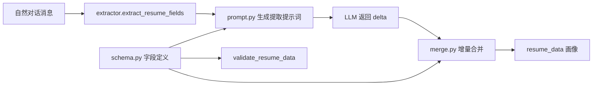

# passive-resume-extractor

[](LICENSE)

一个 **Schema 驱动的「被动简历提取」库**：在用户自然对话中，只提取用户主动提及的信息，并以**增量（delta）**方式合入已有画像——**绝不覆盖、绝不追问、绝不编造**。

零第三方运行时依赖，仅用 Python 标准库。

## 核心理念

- **被动提取**：用户提到才提取，不主动追问、不引导。
- **增量合并**：LLM 只返回「本次变更」，再由 `merge.py` 按字段类型合并，防止多轮对话抹掉旧信息。
- **Schema 驱动**：字段定义、校验、提取 Prompt 全部由 `schema.py` 动态生成——新增字段只需加一条定义，Prompt 自动同步，无需维护第二份文本。

## 架构



## 快速开始

```python
import asyncio
from passive_resume_extractor import (
    extract_resume_fields,
    merge_extracted_fields,
    new_empty_resume_data,
)


class MyLLM:
    """任意实现了 async chat_json 的客户端（DeepSeek / OpenAI / 本地模型）。"""

    async def chat_json(self, system_prompt, user_input, **kwargs):
        # 调用你的 LLM，返回本次提取出的字段
        return {"target_position": "后端开发工程师", "target_location": "杭州"}


profile = new_empty_resume_data()

delta = asyncio.run(
    extract_resume_fields("我想找后端开发，去杭州", profile, MyLLM())
)
merge_extracted_fields(profile, delta)

print(profile["target_position"])  # 后端开发工程师
```

## Delta 合并策略

| 字段类型 | 合并策略 | 示例 key |
| --- | --- | --- |
| 标量 | 直接覆盖 | `name`、`phone`、`target_position` |
| 字典 | `update` 合并 | `hard_skills`、`language_skills` |
| 列表 | 去重追加 | `certificates`、`soft_skills` |
| 重复组（list-of-dict） | `_op: add` 新增 / `_op: update` + `_match` 匹配更新 | `education_list`、`work_experience_list`、`project_experience_list` |

重复组的 delta 形如：

```json
{
  "education_list": [
    {"_op": "update", "_match": {"school": "某大学"}, "gpa": "3.8/4.0"}
  ]
}
```

## 自定义 Schema

在 `schema.py` 中新增一条 `ResumeFieldDef`，提取 Prompt 与校验逻辑会自动同步：

```python
ResumeFieldDef(
    key="github",
    label="GitHub 主页",
    field_type=FieldType.STRING,
    required=False,
    module=ResumeModule.OTHER_INFO,
    extraction_hint="用户提到的 GitHub / 代码仓库链接",
)
```

## 目录结构

```
passive_resume_extractor/
├── schema.py       # 7 大模块字段定义、校验、画像展平
├── merge.py        # 增量合并（标量/字典/列表/重复组）
├── prompt.py       # Schema 驱动的提取提示词
└── extractor.py    # 提取入口（鸭子类型 LLM 客户端）
tests/
├── test_schema.py
├── test_merge.py
└── test_extractor.py
```

## 测试

```bash
python -m pip install pytest
python -m pytest tests/
```

## License

[MIT](LICENSE)
